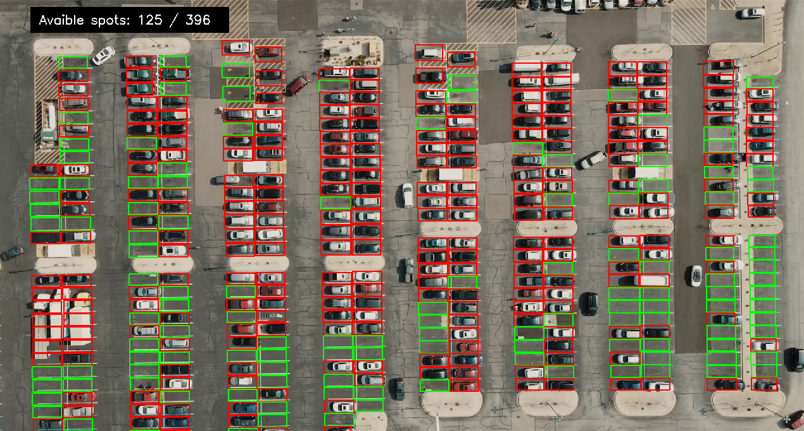

# Parking Spot Detector and Counter 🚗

A computer vision project that analyzes parking-area video footage to identify parking spaces and classify them as **occupied or vacant**. The project uses Python, OpenCV, and a trained machine learning model to process parking-space regions.

## 📌 Project Overview
Finding available parking spaces can be time-consuming in busy parking areas. This project explores an automated approach to parking-space monitoring using video frames, predefined parking-space regions, and machine learning classification.

The system processes a parking video, examines individual parking spaces, and uses a trained classifier to help determine their occupancy status.

## ✨ Features

- **Parking-space detection:** Identifies parking-space regions using predefined coordinates or a mask.
- **Occupancy classification:** Classifies parking-space image regions as occupied or vacant using a trained model.
- **Video processing:** Uses OpenCV to read and process video frames.
- **Parking-space counting:** Supports counting occupied and available parking spaces.
- **Machine learning integration:** Loads a serialized model for classification.
- **Python-based implementation:** Uses commonly used computer vision and machine learning libraries.

## 🛠️ Technologies Used

| Technology   | Purpose                          |
| ------------ | -------------------------------- |
| Python       | Application development          |
| OpenCV       | Video and image processing       |
| NumPy        | Numerical and array operations   |
| scikit-image | Image resizing and preprocessing |
| scikit-learn | Machine learning classification  |
| Matplotlib   | Visualization and plotting       |

## 📁 Project Structure

```text
parking-spot-detector/
│
├── app.py
├── main.py
├── main3.py
├── util.py
├── main.ipynb
├── util.ipynb
├── model_evaluate.py
├── model_evaluate.ipynb
│
├── model/
│   └── model.p
│
├── data/
├── frames/
│
├── mask_1920_1080.png
├── mask_crop.png
├── clf-data.zip
│
├── requirements.txt
├── .gitignore
└── README.md
```

*Note: The files shown above reflect the current project layout. The exact input video and its location should be verified in your local project.*

## ⚙️ Installation and Setup

### 1. Clone the repository

```bash
git clone https://github.com/vraja10/parking-spot-detector.git
cd parking-spot-detector
```

### 2. Create a virtual environment

For Windows:

```powershell
py -3.11 -m venv .venv
```

### 3. Activate the environment

```powershell
Set-ExecutionPolicy -Scope Process -ExecutionPolicy Bypass
.\.venv\Scripts\Activate.ps1
```

### 4. Install the dependencies

For the Python 3.11 environment used during setup, install compatible package versions:

```bash
python -m pip install --upgrade pip
python -m pip install numpy==1.26.4 scipy==1.11.4 scikit-learn==1.1.3 scikit-image==0.22.0 opencv-python==4.9.0.80 matplotlib==3.8.4
```

Alternatively, install the packages listed in the project's `requirements.txt` after verifying that its versions are compatible:

```bash
python -m pip install -r requirements.txt
```

## ▶️ How to Run

### Run the parking-space detector

From the project root, with the virtual environment activated:

```bash
python main.py
```

The script uses the model file at `model/model.p`. Make sure this file is present before running the program.

If the project uses a different input video path, check the video path configured in `main.py` and update it to match your local files.

### Optional: Run the application script

The project also contains `app.py`. If you intend to use its application interface, inspect the script for its entry point and follow the corresponding launch instructions.

## 🧠 How It Works

1. **Input:** Load the parking-area video and the required parking-space mask or coordinates.
2. **Frame extraction:** Read frames from the video using OpenCV.
3. **Region identification:** Identify the individual parking spaces using predefined regions.
4. **Preprocessing:** Resize or prepare each parking-space image region for classification.
5. **Classification:** Use the trained model to predict whether each parking space is occupied or vacant.
6. **Counting and visualization:** Aggregate occupancy predictions and display or visualize the results, as implemented in the application.

## 📦 Model and Dataset

- `model/model.p` — serialized machine learning model used by the detector.
- `clf-data.zip` — archive containing classification-related data; inspect its contents to confirm the dataset structure.
- `data/` — project data directory.
- `frames/` — directory for image frames used by the project.
- `mask_1920_1080.png` and `mask_crop.png` — mask images associated with parking-space regions.

The model and mask must correspond to the preprocessing logic and parking layout expected by the code.

## 🔧 Troubleshooting

**1. Model file not found**

Check that the following file exists:

```text
model/model.p
```

Confirm that the model path in `util.py` matches the actual filename.

**2. Missing Python packages**

Activate the virtual environment and install the required dependencies:

```bash
python -m pip install -r requirements.txt
```

**3. NumPy or scikit-image compatibility error**

Use compatible package versions, such as the pinned versions in the installation section, and verify the imports:

```bash
python -c "import numpy, skimage, sklearn, cv2; print(numpy.__version__, skimage.__version__, sklearn.__version__, cv2.__version__)"
```

**4. Video or mask dimensions do not match**

Check the video dimensions and mask dimensions. The mask must align with the parking layout and coordinate system expected by the code. Do not resize a mask blindly, because the parking-space regions may no longer align.

**5. Model loading or scikit-learn version error**

Serialized models can depend on the scikit-learn version used when they were created. Use a compatible version and only load trusted model files.

## 🚀 Possible Future Improvements

- Real-time parking occupancy monitoring.
- A dashboard showing occupied and available spaces.
- Support for multiple camera views.
- Automated parking-space selection and configuration.
- Occupancy statistics and historical reporting.
- Deployment as a web application.

## 🎯 Project Objective

The objective of this project is to demonstrate how computer vision and machine learning can be combined to automate parking-space occupancy analysis and support more efficient parking management.


## Parking Detection Output

The system detects parking spaces using computer vision.
Green boxes indicate available parking spaces, while red boxes indicate occupied spaces.


